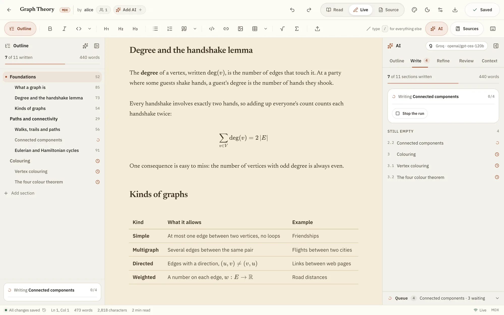
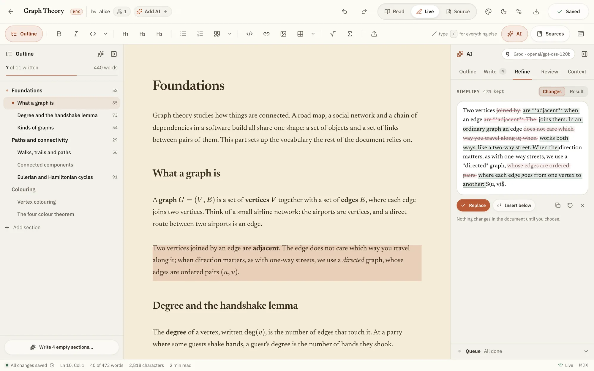
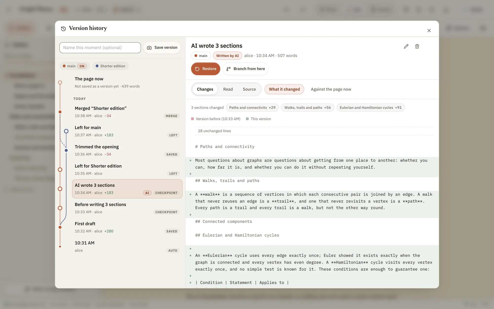
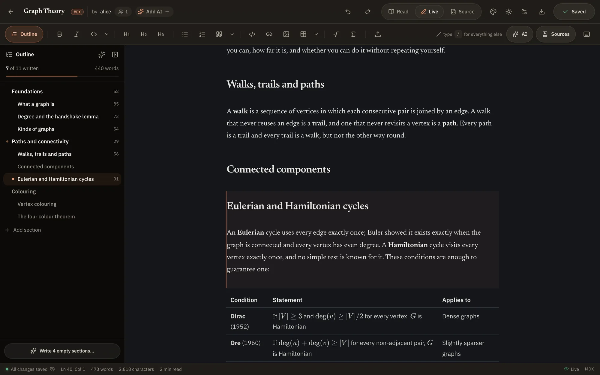

# Topical

**All you need is a topic.**

Topical is an AI-assisted editor for long, structured documents: course notes,
research summaries and technical guides. Give it a subject and it plans an
outline, writes each section in the context of the whole document, and keeps
every change in a version history you can branch and merge. Documents are
written in MDX (Markdown with maths) or LaTeX and render as you type.



## Features

- **Outline first.** A document starts as a tree of sections. The AI can propose an outline, recover one from an existing draft, or restructure the current one, and it gives a reason for every change.
- **Section-by-section writing.** Each section is written in its own request, which knows the section's place in the outline, what neighbouring sections already cover, and the sources you have added. Runs go through a visible queue that waits out rate limits on its own.
- **Checked output.** Generation follows a house style written for a motivated newcomer, and every answer is checked automatically. Headings are fitted to the outline, closing summaries are removed, maths is made renderable, and answers that are cut off or unfinished are requested again.
- **Refine any passage.** Improve, simplify, shorten, expand, set the maths, or explain a passage. Each edit is reviewed as a word-level diff before anything changes.
- **Version history as a graph.** Snapshots are taken before and after every AI run. Versions can be restored, branched, switched and merged section by section, and are stored on the server for every co-author.
- **A live editor.** Headings, tables, KaTeX maths and citations render in place; markup appears only under the caret.
- **Collaboration.** Real-time co-editing with live cursors, invited co-authors, and AI collaborators that review the section you last edited.
- **Your own model.** Works with Gemini, Groq, OpenRouter, Cerebras, Mistral, DeepSeek, Together AI, OpenAI, Anthropic, xAI, or a local Ollama. API keys stay in your browser.
- **Publish and export.** Download a PDF or the `.mdx` / `.tex` source, or publish to a public library with a community forum.

<table>
  <tr>
    <td width="50%"></td>
    <td width="50%"></td>
  </tr>
  <tr>
    <td align="center"><sub>Refine: every edit is reviewed as a diff</sub></td>
    <td align="center"><sub>Version history: branches, restores and merges</sub></td>
  </tr>
  <tr>
    <td colspan="2"></td>
  </tr>
  <tr>
    <td colspan="2" align="center"><sub>Dark theme, with per-document page styles</sub></td>
  </tr>
</table>

## Built with

| Part | Technology |
|---|---|
| Frontend | React 18, TypeScript, Vite, TanStack Router and Query, CodeMirror 6, KaTeX, Yjs, Tailwind CSS |
| Backend | Python, FastAPI, SQLAlchemy (async), Alembic, pycrdt |
| AI | LiteLLM for model providers, Crawl4AI for reading web sources |
| Database | PostgreSQL |

A single FastAPI process serves the REST API (`/api`), the real-time collaboration socket (`/ws`), and the built frontend.

## Run locally

### Prerequisites

- Python 3.10 or newer
- Node.js and npm
- A PostgreSQL database (local or hosted)

### Steps

1. Clone the repository and install the frontend dependencies.

   ```bash
   git clone https://github.com/aryankad1an/topical.git
   ```

   ```bash
   cd topical/frontend && npm install && cd ..
   ```

2. Create your environment file, then set `DATABASE_URL` in it.

   ```bash
   cp .env.example .env
   ```

3. Start the app.

   ```bash
   ./run.sh
   ```

   On the first run this creates a Python virtual environment, installs the
   backend dependencies and Crawl4AI's headless browser, and applies the
   database migrations. It then starts the backend on port 3000 and the
   frontend on port 5173.

4. Open **http://localhost:5173**, create an account, and add a model key under
   **Settings → AI models**.

To run the two processes separately, activate the virtual environment
(`source .venv/bin/activate`), apply migrations with `alembic upgrade head`,
then run `python -m backend` and, in another terminal, `npm run dev` inside
`frontend/`.

### Configuration

Only `DATABASE_URL` is required. The other settings are optional:

| Variable | Default | Purpose |
|---|---|---|
| `DATABASE_URL` | — | PostgreSQL connection string (`postgresql://…`) |
| `PORT` | `3000` | Backend port (the frontend dev server proxies to 3000) |
| `ENVIRONMENT` | `development` | Set to `production` for Secure cookies (requires HTTPS) |
| `SESSION_TTL_DAYS` | `14` | How long an unused sign-in lasts |
| `UPLOADS_DIR` | `./uploads` | Where uploaded images are stored |
| `OLLAMA_API_BASE` | `http://localhost:11434` | Address of a local Ollama server |

Model API keys are not configured on the server: each user adds their own in the app.

### Useful commands

| Command | Purpose |
|---|---|
| `cd frontend && npx tsc --noEmit` | Typecheck |
| `cd frontend && npm run lint` | Lint |
| `cd frontend && npm run build` | Production build |
| `alembic upgrade head` | Apply database migrations |
| `python -m backend.cli writing-check FILE.md` | Score a document's prose (sentence length, readability, repetition) |
| `python -m backend.cli set-password <email>` | Set or reset an account's password |
| `python -m backend.cli seed-demo [--share-with USERNAME]` | Fill the database with demo people, documents and community discussions (`--remove` takes them out) |

With the backend running, the API reference is at **http://localhost:3000/docs**.

## Deployment

The `Dockerfile` builds a single image that serves the whole application and
runs migrations at start-up. `fly.toml` deploys it to Fly.io. Mount a volume at
`/app/uploads` so uploaded images survive redeploys.

```bash
docker build -t topical .
```

```bash
docker run -p 3000:3000 -e DATABASE_URL=postgresql://... -v topical_uploads:/app/uploads topical
```

## License

MIT
